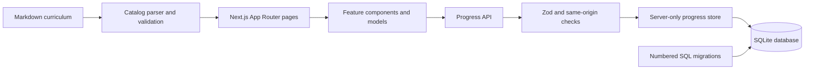

# Architecture and project structure

This document describes the **implemented** Fieldnotes MVP. It is a small, single Next.js application; it is not a service-oriented system.

## Runtime and data flow

- **Curriculum:** `src/content/curriculum/**/*.md` is the source for modules, activities, troubleshooting scenarios, and projects. `src/content/catalog.ts` reads the Markdown frontmatter and sections, validates required fields with Zod, and builds the typed catalog used by the application. `src/content/` also holds the glossary, resource links, taxonomy, learning guidance, and project milestone definitions.
- **Routes:** `src/app/` contains the App Router pages and the `/api/health` and `/api/progress` handlers. Route components compose server-rendered pages with focused interactive components.
- **Features:** `src/features/` groups dashboard, roadmap, activities, projects, progress, and resource-library behavior. Feature models hold calculations and recommendations; shared visual primitives and the application shell live in `src/components/`.
- **Progress:** The progress route validates writes and imports before calling the server-only store. The store uses Drizzle with `better-sqlite3`; the schema is in `src/features/progress/storage/schema.ts`, and ordered SQL migrations are in `migrations/`. Applied migration filenames are recorded in `schema_migrations`.
- **Storage:** Direct local runs use `DATABASE_PATH` when set, otherwise `.data/lms.sqlite`. Compose sets `/data/lms.sqlite` and mounts `/data` to the persistent `learning-data` volume.

Curriculum content and learner progress are separate sources of truth: Markdown defines what can be learned; SQLite contains saved learner records. A lesson view does not create a completion record, and completion is a learner self-report rather than a mastery assessment.

## Directory guide

| Path | Responsibility |
| --- | --- |
| `src/app/` | Routes, layouts, and HTTP handlers |
| `src/components/` | Shared application shell and UI primitives |
| `src/features/` | Feature-specific presentation, models, and persistence boundaries |
| `src/content/` | Curriculum catalog, Markdown content, glossary, and references |
| `public/library/` | The eight source PDFs served by the Resource Library |
| `migrations/` | Versioned SQL schema changes |
| `scripts/` | Local standalone-server startup and post-build asset/migration copying |
| `tests/e2e/` | Playwright browser-level tests |
| `docs/` | Maintainer-facing architecture and development guidance |
| `.github/workflows/` | GitHub Actions CI |

The root is intentionally reserved for entry points and tool-discovered configuration: `package.json` and its lockfile, Next.js and TypeScript configuration, lint/PostCSS configuration, shadcn configuration, Playwright/Vitest configuration, Docker files, the environment template, and the GitHub-facing README. Keep these in the root unless the relevant tool is explicitly configured for another path. Next.js also generates `next-env.d.ts` and TypeScript may generate `tsconfig.tsbuildinfo`; both are ignored build artifacts, not source files.

## Build and deployment shape

`next.config.ts` uses Next.js standalone output. `scripts/prepare-standalone.mjs` copies the static assets, public files, and root `migrations/` directory into `.next/standalone`; the production image runs that server as a non-root user. Compose binds to loopback by default and keeps database files in a named volume. Keep the migration location and copy step in sync if either path changes.

## Current boundaries and future ideas

Implemented behavior is local-first and single-user. There is no login, authorization system, multi-user sharing, cloud synchronization, hosted deployment configuration, automatic backup, AI tutor, grading, deadline system, or lab-command execution/provisioning. These are possible future design topics, not current functionality or committed roadmap items. In particular, the same-origin check on progress writes is a request-integrity check; it is not user authentication.
