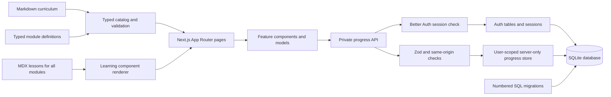

# Architecture and project structure

This document describes the **implemented** Fieldnotes MVP. It is a small, single Next.js application; it is not a service-oriented system.

## Runtime and data flow

- **Curriculum:** Typed module metadata, preserved lesson overviews, and stable lesson IDs live in `src/content/curriculum/modules/definitions.ts` and are validated with the Zod schema in `src/content/module-definitions.ts`. Explanations for all 24 modules live in lesson-sized `.mdx` files under each module's `lessons/` directory. `src/mdx-components.tsx` registers shared React layouts, diagrams, command examples, callouts, and practice-only knowledge checks. Activities, troubleshooting, projects, and reference materials remain Markdown where the catalog already supports it.
- **Routes:** `src/app/` contains the App Router pages, public `/privacy` and `/terms` pages, and the `/api/health`, `/api/progress`, and Better Auth `/api/auth/*` handlers. `/modules/NN` is a module overview; `/modules/NN/lessons/mNN-lNN` renders one lesson with its module outline and previous/next links. Curriculum pages are public; `/api/progress` requires a valid session and always uses the signed-in user ID from that session.
- **Features:** `src/features/` groups dashboard, roadmap, activities, projects, progress, and resource-library behavior. Feature models hold calculations and recommendations; shared visual primitives and the application shell live in `src/components/`.
- **Progress:** Module summaries, individual lessons, activities, projects, troubleshooting items, and milestones have separate records per learner. Lesson completion is an optional self-report and does not block navigation or indicate mastery; activity evidence remains on its activity record. A01 stores five independently editable task observations in the same A01 row used by its final review. Older unassigned `notes` and `evidence` remain intact. Older v1/v2 JSON imports remain supported; export uses version 3. The progress API validates input, checks the session, and calls the user-scoped server-only store. The storage key is `(user_id, item_type, item_id)`.
- **Authentication:** `src/features/auth/auth.server.ts` configures Better Auth with the existing Drizzle/SQLite connection. Production fails closed unless its canonical app origin is public HTTPS and matches `FIELDNOTES_PUBLIC_URL`; Compose maps production-prefixed secrets and provider credentials separately from local settings. The configured owner role requires a verified matching email. Local email/password sign-up exists only for Playwright test runs and is disabled in production. Sessions are stored in SQLite, can last up to 30 days with regular use, and can be revoked from the account page. Deletion requires a `DELETE` confirmation and a session fresher than 10 minutes. OAuth tokens are encrypted with the Better Auth secret; notes are not encrypted at rest.
- **Existing-data migration:** migration `0004_add_auth_and_progress_ownership.sql` creates Better Auth tables, copies existing shared records to `legacy_progress`, and replaces `learning_progress` with an account-scoped key. On a verified sign-in whose email matches `FIELDNOTES_OWNER_EMAIL`, the legacy rows are copied into that owner and the temporary archive is cleared in one SQLite transaction. No other account can read or claim it. Migration `0005_purge_legacy_progress_on_owner_deletion.sql` removes any still-unclaimed archive when the admin owner is deleted. Keep applied migrations immutable; future changes need a new numbered migration.
- **Storage:** Direct local runs use `DATABASE_PATH` when set, otherwise `.data/lms.sqlite`. Compose sets `/data/lms.sqlite` and mounts `/data` to the persistent `learning-data` volume. Auth and learner records share the same host database; account separation is enforced by session-derived IDs and user-scoped queries.

Curriculum content and learner progress are separate sources of truth: typed module definitions, reviewed MDX, and the existing Markdown content define what can be learned; SQLite contains auth data and saved learner records. A lesson view does not create a completion record, and completion is a learner self-report rather than a mastery assessment. Public lesson access does not reveal account records.

MDX is compiled from repository-owned source during the Next.js build. Treat it as executable application code: do not accept learner uploads or other untrusted MDX for server rendering. Knowledge checks are transient practice state; saved learning notes and activity evidence continue to use the existing SQLite progress store.

## Directory guide

| Path | Responsibility |
| --- | --- |
| `src/app/` | Routes, layouts, and HTTP handlers |
| `src/components/` | Shared application shell and UI primitives |
| `src/features/` | Feature-specific presentation, models, and persistence boundaries |
| `src/content/` | Typed curriculum definitions, MDX and Markdown content, glossary, and references |
| `public/library/` | The eight source PDFs served by the Resource Library |
| `migrations/` | Versioned SQL schema changes |
| `scripts/` | Local standalone-server startup and post-build asset/migration copying |
| `tests/e2e/` | Playwright browser-level tests |
| `docs/` | Maintainer-facing architecture and development guidance |
| `.github/workflows/` | GitHub Actions CI |

The root is intentionally reserved for entry points and tool-discovered configuration: `package.json` and its lockfile, Next.js and TypeScript configuration, lint/PostCSS configuration, shadcn configuration, Playwright/Vitest configuration, Docker files, the environment template, and the GitHub-facing README. Keep these in the root unless the relevant tool is explicitly configured for another path. Next.js also generates `next-env.d.ts` and TypeScript may generate `tsconfig.tsbuildinfo`; both are ignored build artifacts, not source files.

## Build and deployment shape

`next.config.ts` uses Next.js standalone output. `scripts/prepare-standalone.mjs` copies the static assets, public files, and root `migrations/` directory into `.next/standalone`; the production image runs that server as a non-root user. Compose binds to loopback by default and keeps database files in a named volume. Keep the migration location and copy step in sync if either path changes.

## Current boundaries and future ideas

Implemented behavior is self-hosted and multi-account within one local SQLite file. There is no cloud-hosted learner database, organization/team account model, automatic inactive-account deletion, automatic backup, AI tutor, grading, deadline system, or lab-command execution/provisioning. Account deletion removes records from the active database but not downloaded exports or backup copies. A same-origin check on writes is defense in depth; authentication and session-derived ownership provide the access boundary.
