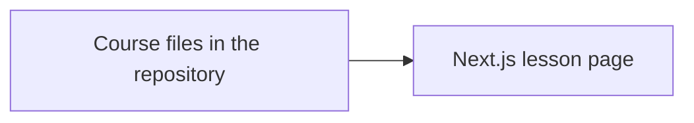
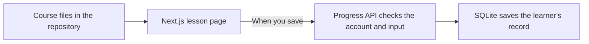

# Fieldnotes audit fixes explained

Fieldnotes is still one Next.js application. The lessons come from files in the repository. Saved progress belongs to a signed-in learner and lives in SQLite. Most fixes make the rules between those parts easier to follow and harder to break.

This walkthrough follows the numbering of the [implementation guide](fieldnotes-audit-implementation-guide.md). It describes the changes in the local checkout and explains the decisions behind them.

## How Fieldnotes fits together

When you open a lesson, Next.js uses the course catalog to find the right Markdown or MDX file. MDX lets a lesson use React components for things like diagrams, command examples, and knowledge checks. The course is public, so you can read the lesson before signing in. Opening it creates no saved completion record. [Architecture overview](architecture.md)

Saving a learning note adds a second path. The browser calls the progress API. On every request, the server uses Better Auth to identify the learner, validates the request, and uses Drizzle to read or write SQLite. A record is identified by the learner, the kind of learning item, and its ID. Two learners can each have an A01 record with different contents. [Progress API](../src/app/api/progress/route.ts) · [SQLite storage](../src/features/progress/storage/database.ts)

A **draft** is what you have typed so far in the browser. A **saved record** is what the server has accepted and stored. A **revision** is the row’s version number and protects against overwriting someone’s newer save. A **timestamp** is the last-saved time and helps order records and compare backups. Those four ideas explain most of the progress fixes. [Draft storage](../src/features/progress/progress-draft.ts) · [Progress model](../src/features/progress/model.ts)

## 1. Protect learner data

### 1.1 Keep local SQLite outside the build output

`npm start` runs Next.js’s packaged server from `.next/standalone`. The old default looked for the database relative to wherever the server happened to be running. That could put a learner’s database inside the same folder a rebuild replaces.

The local launcher now resolves the database path before it starts the packaged server. By default it uses `.data/lms.sqlite` at the repository root. It respects an explicit database path and supports `:memory:` for disposable runs. Docker already has its own persistent volume at `/data`. The build also excludes local database and environment files from the packaged server.

Changing the startup path fixes the problem where it begins. Automatically moving an older database would require guessing which copy has the right records. The recovery notes tell an operator how to inspect both first. [Local launcher](../scripts/start-local.mjs) · [Next.js configuration](../next.config.ts) · [Standalone build preparation](../scripts/prepare-standalone.mjs) · [Recovery notes](development.md)

### 1.2 Reject bad backup dates and keep old records readable

A backup could contain a number so large that JavaScript could never turn it into a date. The old import accepted it. Opening the Progress notebook could then fail when it tried to format that date, taking the backup controls off the page too.

Backup versions 1, 2, and 3 now check timestamps against JavaScript’s date range and a 24-hour future limit. A date outside the supported range already stored in SQLite gets a readable fallback in the UI. The learner can still see the record and save it through its current revision to repair the timestamp.

The two checks belong at different points. The import check prevents new bad data. The display fallback keeps records from older versions accessible. [Import validation](../src/features/progress/validation.ts) · [Timestamp rules](../src/features/progress/timestamp.ts) · [Date display](../src/features/progress/date-format.ts)

### 1.3 Preserve a later save when computer clocks differ

Suppose two Fieldnotes installations share a backup. One computer’s clock is behind. Previously, an edit there could keep the exact timestamp from the original row. The other installation then saw equal timestamps and kept its older text.

When a learner saves, Fieldnotes normally uses the later of the current time and the previous timestamp plus one millisecond. The small increase gives a real edit a later timestamp even on a slow clock or when two saves happen in the same millisecond. A bounded internal allowance handles saves near the future cutoff. Incoming backups still follow the 24-hour rule. When applying a backup, SQLite compares each incoming row with what is saved **at that moment**. Equal timestamps keep the destination row, so repeating the same import leaves it alone.

The preview is now labelled an estimate because a learner could save again between preview and apply. The final import result reports what the transaction actually did. This gives Fieldnotes useful protection for moving backups between installations. Two separate installations can still make independent edits with the same timestamp. Resolving that case automatically would require a fuller synchronization design. [Storage ordering](../src/features/progress/storage/database.ts) · [Backup UI](../src/features/progress/progress-backup.tsx)

## 2. Verify releases and recovery

### 2.1 Make the public Compose release repeatable

The base Compose file describes the app, its loopback port, and its persistent data volume. The existing Cloudflare overlay adds the network and alias the Tunnel uses to reach Fieldnotes. A running container can have the right network today while the operator’s next recreation command forgets the overlay.

The runbook now uses the same two Compose files for validation and public recreation. The image also records its declared source revision in a standard image label. CI uses the checked-out commit. Local builds with uncommitted edits use the label `uncommitted`. The revision tells you which source was declared. The image ID identifies what Docker built and can run. [Base Compose file](../compose.yaml) · [Tunnel overlay](../compose.cloudflare.yaml) · [Release runbook](development.md)

### 2.2 Start and check the actual image built by CI

Playwright drives the app in a development server. It can catch a broken Save button or an incorrect sign-in screen. A Docker image can still fail because it is missing a native SQLite library, a migration, a lesson asset, or write access to `/data`.

CI now takes the image ID from the build and starts that exact image with disposable storage. The smoke test checks the non-root runtime user, startup and readiness, the packaged and applied migrations, lesson assets, the lab ZIP, and the guest response from the private API. Running the exact image keeps the check tied to the artifact a release would use. [CI workflow](../.github/workflows/ci.yml) · [Image smoke test](../scripts/smoke-image.mjs)

### 2.3 Give Playwright its own server and data

The old test setup could see a healthy response on the chosen port and assume it came from the server it had just launched. If another server already owned the port, the test could send its synthetic sign-up requests there.

Playwright now starts its server through its built-in `webServer` setting with reuse disabled. Each run has its own temporary SQLite database and synthetic accounts. Cleanup happens after the server releases the database files. In the occupied-port check, the other listener received a health probe and zero sign-up requests. Using the test runner’s server lifecycle avoids maintaining a second set of process ownership rules. [Playwright configuration](../playwright.config.ts) · [Cleanup reporter](../tests/e2e/run-cleanup-reporter.ts) · [Playwright web server documentation](https://playwright.dev/docs/test-webserver)

### 2.4 Rehearse a proper SQLite restore

SQLite uses a **write-ahead log**, usually called a WAL. Recently committed writes can still be in this companion log. Copying just the main database file from a running app can miss those writes.

The runbook uses SQLite’s backup API to make a consistent copy and restores it to a separate location for inspection. The rehearsal checked database integrity, references between tables, and the list of applied migrations. It started the restored app and checked account-scoped access to synthetic progress. The operator also needs the matching auth secret for recovery of protected account data. The backup and secret belong in protected storage. A learner’s exported JSON contains their progress and covers a different recovery need. [Recovery runbook](development.md) · [Restore rehearsal](../scripts/rehearse-sqlite-restore.ts) · [SQLite backup API](https://sqlite.org/backup.html)

## 3. Fix the learner experience

### 3.1 Keep instructions public and private editing read-only for guests

A signed-out visitor could open an activity and type into a note field, then see the text disappear because saving required an account. The activity now keeps instructions, command hints, and task navigation usable and disables private editing until the account and record are usable. The save logic checks the same conditions. The form communicates what the server can actually accept. [Activity workbench](../src/features/activities/activity-investigation-workbench.tsx) · [Guest browser regression](../tests/e2e/guest-activity-nav.spec.ts)

### 3.2 Let the browser receive the renewed session cookie

A **session cookie** is what the browser sends on later visits so the server can recognize the signed-in learner. A server component asking Better Auth who the learner was could also extend the session in SQLite. That internal call returned the session object. The cookie from that call never reached the browser. A later browser request could find the session already renewed and get no new cookie.

Server-side identity checks now ask Better Auth to skip renewal. The browser’s call to the auth route can do the renewal and receive the new cookie on the same HTTP response. Better Auth still owns session rules. Fieldnotes chooses which call can deliver the cookie correctly. [Auth server](../src/features/auth/auth.server.ts) · [Cookie renewal regression](../tests/e2e/session-renewal.spec.ts)

### 3.3 Make checkpoint links select the right step

In project S02, someone could be editing S02.3 and click a Review link to S02.2. The address changed while the editor stayed on S02.3 because an older selection had priority. The address fragment, the part after `#`, now wins when it names a valid checkpoint. Build switches to that checkpoint and keeps the existing notebook mounted, so choosing another step does not throw away text. A project-specific location helper keeps direct links and browser Back and Forward in sync. [Project location helper](../src/features/projects/project-location.ts) · [Checkpoint workbench](../src/features/projects/milestone-checklist.tsx)

### 3.4 Keep command help open while someone types

Typing into React state causes the page to update. The old Markdown renderer made new component functions during these updates. React treated some instruction elements as replacement components. An open help section could close and code-copy controls could be reset.

Activity task rendering now uses stable component functions. Interactive task buttons and hints get their changing values from the activity, and ordinary Markdown still uses the shared renderer that can run on the server. The learner can keep a command explanation open next to the note they are writing. [Activity Markdown renderer](../src/components/ui/activity-task-markdown-content.tsx) · [React’s explanation of component identity](https://react.dev/learn/preserving-and-resetting-state)

### 3.5 Return keyboard focus to the right control

On a narrow screen, the menu drawer could stay open over the Account or Sign in page. The activity notebook could also send keyboard focus to the general notebook button after you had opened it from a specific task. In the project notebook, Tab skipped the native disclosure button for project-wide notes while the form was loading.

Account navigation now closes the menu. The activity notebook remembers the control that actually opened it and returns focus there on dismissal. The project notebook includes the visible disclosure button in its Tab order. Keeping the native `
` control gives keyboard users a standard way to open the section. [Account navigation](../src/features/auth/account-navigation.tsx) · [Activity keyboard checks](../tests/e2e/activity-markdown-focus.spec.ts) · [Project keyboard checks](../tests/e2e/project-workbench.spec.ts)

## 4. Give each kind of progress state a clear owner

### 4.1 Return what SQLite actually saved

A save can leave some fields out. For example, updating project status can omit the list of checkpoint observations. SQLite should preserve the existing observations when the field is omitted. The old success response was assembled from the incoming request, so the browser could see an empty set of observations immediately after a successful save.

The insert or update now returns the row directly from SQLite. The response therefore contains the same revision and observations a later read would return. Leaving the observation field out preserves it. Sending an explicitly empty set can clear it. The API has one reliable answer for what was saved. [SQLite write and row mapping](../src/features/progress/storage/database.ts) · [Storage regression tests](../src/features/progress/storage/database.test.ts)

### 4.2 Separate auth failures and share the project’s saved copy

The app now knows whether it is checking a session, the visitor is signed out, the learner is signed in, or the account service is temporarily unavailable. Guests can browse without first sending requests for private progress that would receive 401. During an outage the UI offers a retry and hides private records. A request whose expected account differs from the actual session gets a separate account-change response. The API uses the authenticated session to decide ownership.

Build and Review previously fetched the same project detail separately. They now share one saved copy for the current learner and project, loaded when either stage needs it. Build can have newer unsaved text. Review reads the last saved copy. A save publishes the row returned by SQLite, and a restore makes the project fetch again. The existing lightweight summary still supplies checkpoint status. A project-specific copy solves the duplicate read with a clear place to discard old data on account change. [Session states](../src/features/auth/auth-session-context.tsx) · [Project saved record](../src/features/projects/project-record-context.tsx) · [Progress read tests](../tests/e2e/progress-read-ownership.spec.ts)

### 4.3 Reuse the same record rules across editors

Previously, the general editor and activities each implemented their own rules for loading, restoring a draft, detecting a conflict, and saving. Whenever one implementation changed, the other could behave differently. One shared React hook now owns those rules. The screens still choose their own prompts, labels, and when to allow typing. An activity locks its form while saving. A project can keep accepting typed text during a slow save.

For example, you open a project at revision 7 and save a note. While the request is in progress, you add another sentence. SQLite accepts the first edit and returns revision 8. Fieldnotes keeps the extra sentence as an unsaved draft and uses revision 8 as the starting point for the next save. If another device has already saved a newer version, Fieldnotes shows a conflict and lets you choose which copy to use. Drafts are kept by account and learning item, so a switch to another account starts with that account’s data. [Shared progress hook](../src/features/progress/use-progress-record.ts) · [Draft storage](../src/features/progress/progress-draft.ts) · [Account-switch and save tests](../tests/e2e/progress-record-lifecycle.spec.ts)

A01 and the other activities also share the same workbench for task selection, the notebook, and Review. A01 supplies its own five task IDs, prompts, and guidance. The shared earlier-record editor now lets an A01 learner view, edit, or clear an old repository URL, even if that URL is the only field on the old record. The code can share interaction rules while letting each lesson teach its own material. [Activity workbench](../src/features/activities/activity-investigation-workbench.tsx) · [A01 task catalog](../src/features/activities/a01-task-catalog.ts)

### 4.4 Give the dashboard only the project data it uses

The dashboard needs project titles and checkpoint labels to show **Up next** and **Recent work**. It used to receive the full checkpoint instructions and parse them repeatedly. The server now supplies the small set of IDs and labels already available in the course catalog. The dashboard builds its lookups once. Full guidance stays on the project page.

The same change fixes completed projects showing up as new recommendations. Project completion and individual checkpoint completion remain independent facts. A learner can still open a completed project and see or edit its history. For the same 11 projects and 55 checkpoints, the implementation measurement went from **51,967 to 4,000 serialized JSON bytes**. Those figures describe the data itself. [Dashboard server data](../src/features/dashboard/content.server.ts) · [Dashboard recommendations](../src/features/dashboard/model.ts) · [Dashboard tests](../src/features/dashboard/model.test.ts)

## 5. Remove code that has stopped being useful

### 5.1 Fix the notebook’s CSS and remove unused UI options

The project editor emitted one CSS class while the stylesheet expected another, so the browser skipped the intended rules. Both now use the same class. Chromium checked the resulting desktop and compact layouts.

The cleanup removed unused components and editor options. The shared Button now wraps a native HTML button with the classes its callers already use. This preserves ordinary button behavior, such as keyboard focus, disabling, and submitting a form. Radix and the button-variant package had no remaining callers, so they were removed. The stylesheet directly imports a highlighting theme, so `highlight.js` is now an explicit dependency at the already-installed version. The lockfile lost 75 package entries while retaining the same versions for the remaining packages. [Global styles](../src/app/globals.css) · [Button](../src/components/ui/button.tsx) · [Package manifest](../package.json)

### 5.2 Keep the current lesson registration until there is a reason to change it

This was the conditional task. The existing setup combines lesson metadata, explicit MDX imports, and module wrappers. A new registry could reduce the number of edits needed for future lessons. It would also change how modules are brought into the build, so it carries more work and risk than the current evidence warrants. The curriculum checks cover the existing 24 module overviews and 77 lessons. The guide ties this refactor to an actual lesson addition that demonstrates repeated friction. [Conditional guide item](fieldnotes-audit-implementation-guide.md#52-reduce-lesson-registration-work-if-authoring-needs-it) · [Curriculum tests](../src/content/content.test.ts)

### 5.3 Make A08 match the downloaded Status API lab

The A08 instructions previously showed Python 3.13 and a volume mounted at `/lab-data`. The downloaded starter uses Python 3.12 and prepares `/data` for UID and GID 10001, the numeric identity of its non-root user. Using the old mount path could put the volume outside the directory the image prepared for writes.

The lesson and starter now agree. The exercise shows that a named volume has a separate lifetime from a container. The non-root process writes one marker under `/data` and another under `/tmp`. After container recreation, the volume marker is still there and the container-layer marker is gone. The ZIP is regenerated from the tracked starter files, and CI checks that the download matches those files byte for byte. [A08 instructions](../src/content/curriculum/activities/A08.md) · [Status API starter](../public/labs/status-api/README.md) · [Archive check](../scripts/verify-status-api-archive.py) · [Docker volume behavior](https://docs.docker.com/engine/storage/volumes/#mounting-a-volume-over-existing-data)

## What the checks established

| Check | What it showed |
| --- | --- |
| 74 Vitest tests | Record validation, backup ordering, storage behavior, and dashboard rules worked against the test cases. |
| 64 Chromium tests | Learners could navigate, edit, save, recover drafts, switch accounts, and use the tested keyboard flows. The browser also exercised the public curriculum routes. |
| Windows production build and SQLite recovery rehearsal | The packaged server built successfully, and the restored synthetic database passed integrity, migration, readiness, and account-isolation checks. |
| Linux image smoke and Compose validation | The checked image ran as UID 1001, applied all seven migrations, served the expected assets, and returned 401 for anonymous private progress. |
| Three Python 3.12 tests and the A08 Docker rehearsal | The extracted lab passed its tests. The named-volume marker survived recreation under the lab’s non-root user. |

The guest browser scenario went from six private progress GET attempts to zero. The signed-in Build → Review scenario used one project-detail GET. These were counts in the tested flows. Hosted CI execution, live OAuth, and production deployment remain unverified. [Read ownership tests](../tests/e2e/progress-read-ownership.spec.ts) · [CI workflow](../.github/workflows/ci.yml)
